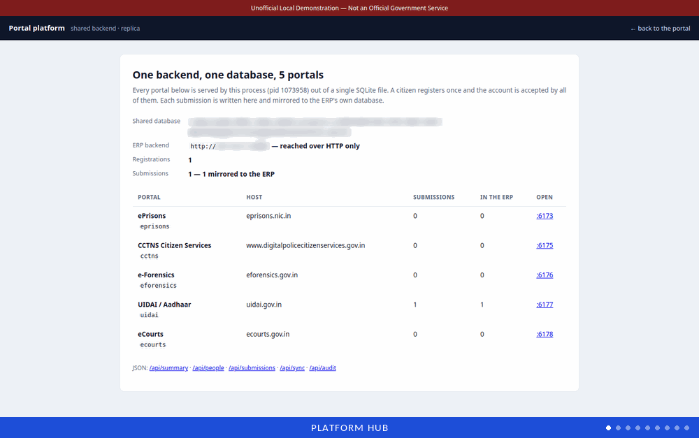
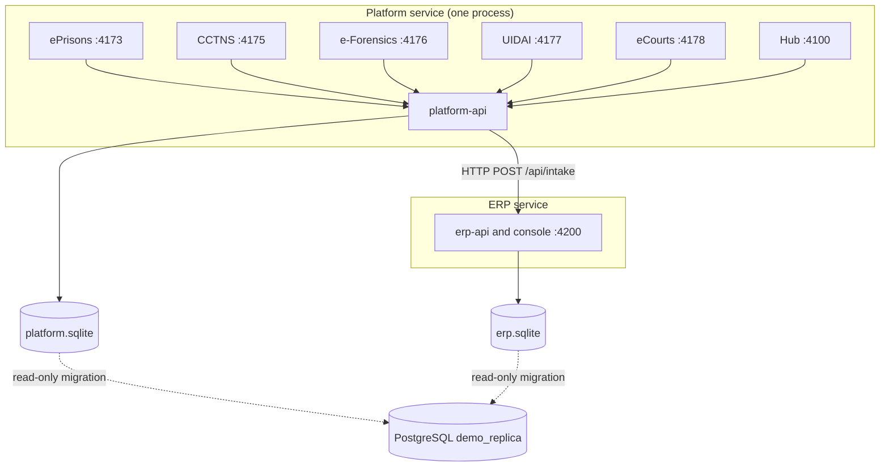
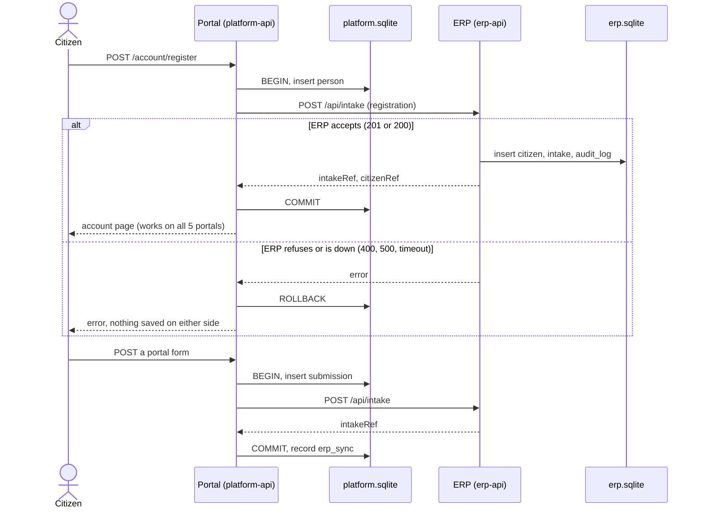
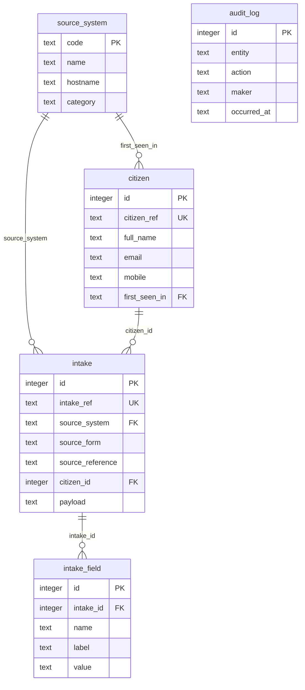
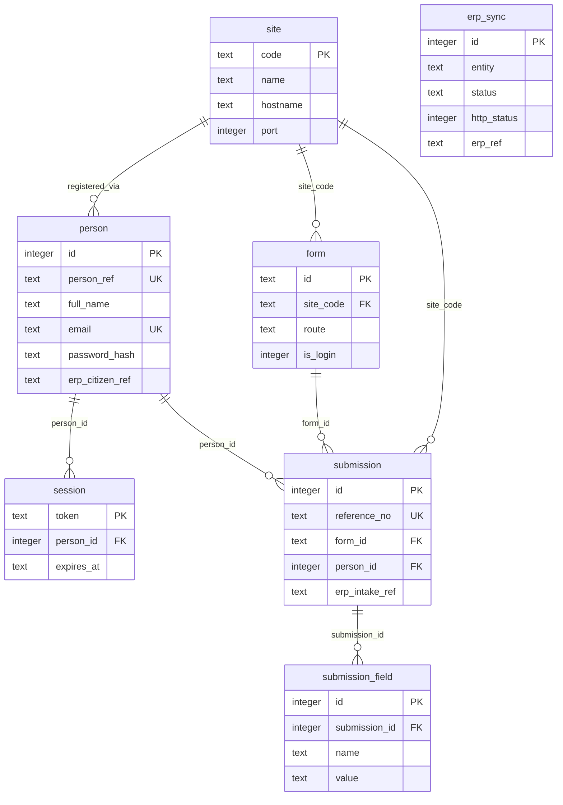
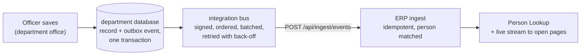
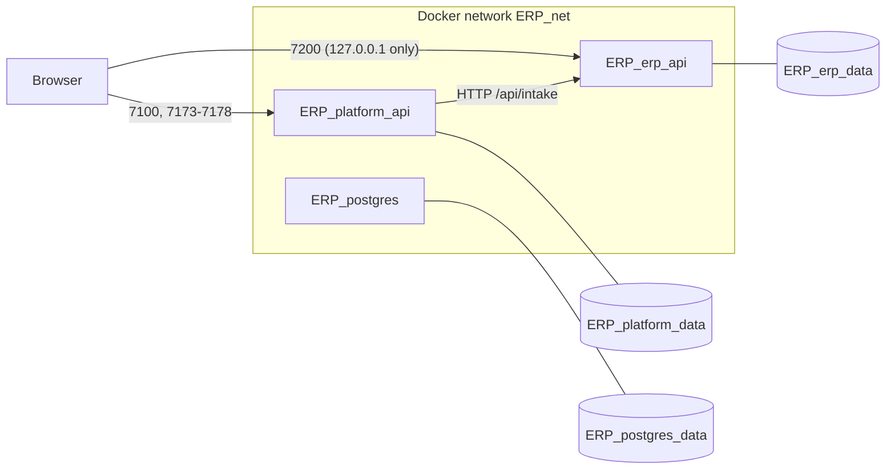

# 4_ERP

An ERP for Maharashtra Prisons, and local demonstration replicas of the government portals it has to exchange data with.

<br/>

-green)


## Table of Contents

- [Introduction](#introduction)
- [Key Features](#key-features)
- [Screenshots](#screenshots)
- [System Architecture](#system-architecture)
- [Tech Stack](#tech-stack)
- [Open-Source Tools and Libraries](#open-source-tools-and-libraries)
- [Project Structure](#project-structure)
- [Database Design](#database-design)
- [API Design](#api-design)
- [Installation and Setup](#installation-and-setup)
- [Usage](#usage)
- [Deployment](#deployment)
- [Versioning and Releases](#versioning-and-releases)
- [Security Considerations](#security-considerations)
- [Testing](#testing)
- [Monitoring and Logging](#monitoring-and-logging)
- [Performance and Scalability](#performance-and-scalability)
- [Future Roadmap](#future-roadmap)
- [Contributing](#contributing)
- [License](#license)
- [Contact / Credits](#contact--credits)
- [Assumptions](#assumptions)

## Introduction

> **Unofficial Local Demonstration — Not an Official Government Service.**
> No directory here contains an official government service, none of them may be
> deployed anywhere the public could mistake one for the real thing, and no
> replica ever contacts the site it replicates.

**Overview.** This repository holds the ERP for Maharashtra Prisons (its own backend, console and database) together with local demonstration replicas of five government portals the ERP must exchange data with: ePrisons, CCTNS, e-Forensics, UIDAI (Aadhaar) and eCourts. The replicas run from one shared backend and one shared database. Every submission made on a portal is written to the portal database and to the ERP database, or to neither.

**Problem statement.** The research reports in `info/docs/research_reports/` establish that none of the external systems the ERP must integrate with publishes a public API: every one is paper-based, CAPTCHA-protected, or behind an authenticated login on a closed network. Without a stand-in, ERP integration work depends on access to production government systems, and a citizen or officer has to retype the same data on every portal.

**Objectives.**

1. Provide a faithful reference for the fields, validation rules and workflows the ERP has to mirror, so data is never retyped.
2. Provide a local stand-in for integration work, so development does not depend on a production government system.
3. Prove, with tests that read both databases, that a record is stored in both places or in neither.

**Scope.** In scope: the ERP backend and console, the shared portal backend, five portal replicas and a hub, SQLite storage, a PostgreSQL migration and backup, and a Docker stack. Out of scope: contacting any real government site, visual pixel-fidelity of the replicas (field-level fidelity is the part the ERP depends on; see [`backend/gov_replica/README.md`](backend/gov_replica/README.md)), and the three of the eight source systems in `info/docs/requirements/erp-scope.pdf` that have not been replicated yet.

## Key Features

- **Five portal replicas** (ePrisons, CCTNS, e-Forensics, UIDAI, eCourts): each keeps the port it always had, so existing URLs still work.
- **One shared backend and database**: a citizen registers once and the account works on every portal.
- **Write-through to the ERP**: every submission is stored in both databases, or rolled back from both.
- **ERP intake console**: overview, received records, citizens and an audit trail.
- **Person lookup**: one identifier (Aadhaar, mobile, CNR, FIR, prisoner number, name ...) shows what UIDAI, CCTNS, e-Forensics, eCourts and ePrisons hold about the person, with a case journey and a stepper per record. See [Person lookup](#person-lookup).
- **Department offices**: each of the five portals has its own officer sign-in, dashboard, research-based forms and database at `/office`; every record saved there reaches the ERP within milliseconds through a signed, retried, idempotent integration bus. See [Department offices and the integration bus](#department-offices-and-the-integration-bus).
- **Append-only audit trail**: database triggers reject every UPDATE and DELETE on `audit_log`.
- **Idempotent intake**: a retried submission with the same `(sourceSystem, sourceReference)` never creates a duplicate.
- **Hub page**: one page showing the whole arrangement, with JSON endpoints for summary, people, submissions, sync attempts and audit.
- **Docker stack**: hardened containers (read-only filesystem, all capabilities dropped) with every object prefixed `ERP_`.
- **PostgreSQL migration and backup**: the SQLite data copied read-only into five PostgreSQL tables.
- **End-to-end tests** that read both SQLite files directly, plus a rollback test.

## Screenshots



## System Architecture

**Style.** Two cooperating Node.js services that share nothing but HTTP: a platform service (five portal listeners and a hub, one process, one SQLite file) and the ERP service (its own process and SQLite file). The platform calls the ERP; the ERP never calls a portal and never opens the platform database, and the portals never open the ERP database. Two tests assert both directions by reading the source with comments stripped. This keeps the ERP a deployable product on its own, while the replicas stay disposable.



**Main workflow: a citizen registers once and submits a form.**



A drawn version (runtime topology, the write-through step by step, and an entity-relationship diagram of both databases) is in [`info/docs/architecture/blueprint.html`](info/docs/architecture/blueprint.html): one self-contained HTML file, open it in a browser. [`info/docs/architecture/ARCHITECTURE.md`](info/docs/architecture/ARCHITECTURE.md) covers the same ground in text.

| Port | Process |
|---|---|
| 4100 | Platform hub |
| 4173 / 4175 / 4176 / 4177 / 4178 | ePrisons / CCTNS / e-Forensics / UIDAI / eCourts |
| 4200 | ERP backend and console (`127.0.0.1` only) |

## Tech Stack

| Layer | Technology | Purpose | Why chosen |
|---|---|---|---|
| Frontend | React 18 + TypeScript, built with Vite 5; Tailwind CSS 3 for the sign-in and account pages | Portal replicas, hub, ERP console, sign-in and account pages | Pages are drawn on the server (the replica suites read the HTML) and hydrated in the browser; each site keeps its own look. The EJS views remain as a fallback (`UI_ENGINE=ejs`) |
| Backend | Node.js 18, Express 4 | ERP API and platform API | Small, well-known stack; one language end to end |
| Database | SQLite (better-sqlite3) | `erp.sqlite` and `platform.sqlite` | Zero-administration, transactional, easy to copy and inspect |
| Database (target) | PostgreSQL 16 | `demo_replica` migration target | Production-grade store for the migrated data |
| Cache | None | | Not needed at demonstration scale |
| Message queue | None | Write-through is a synchronous HTTP call | Required so both databases commit together or not at all |
| AI/ML | None | | |
| DevOps | Docker, Docker Compose | Reproducible two-service stack plus PostgreSQL | Hardened images, named `ERP_` objects, healthchecks |
| Testing | Node.js scripts, Bash | End-to-end and rollback tests | Tests read both databases directly |
| Crawl tooling | Playwright, cheerio, pixelmatch, pngjs | Capturing and comparing the replicated sites (`backend/tools`) | Reproducible replica generation |

## Open-Source Tools and Libraries

| Tool | Category | License | Purpose | Link |
|---|---|---|---|---|
| Node.js | Runtime | MIT | Runs both services | https://nodejs.org |
| Express | Web framework | MIT | HTTP routing for the APIs and portals | https://expressjs.com |
| EJS | Templating | Apache-2.0 | Server-rendered views | https://ejs.co |
| better-sqlite3 | Database driver | MIT | Synchronous SQLite access with transactions | https://github.com/WiseLibs/better-sqlite3 |
| SQLite | Database | Public domain | Storage for both services | https://sqlite.org |
| PostgreSQL | Database | PostgreSQL License | Migration target and backup | https://www.postgresql.org |
| Playwright | Browser automation | Apache-2.0 | Capturing replicated sites (`backend/tools`) | https://playwright.dev |
| cheerio | HTML parser | MIT | Extracting markup in the replica pipeline | https://cheerio.js.org |
| pixelmatch | Image diff | ISC | Visual comparison of replicas | https://github.com/mapbox/pixelmatch |
| pngjs | Image library | MIT | PNG reading and writing in the pipeline | https://github.com/pngjs/pngjs |
| Docker and Compose | Containers | Apache-2.0 | Packaging and running the stack | https://www.docker.com |

## Project Structure

```
4_ERP/
├── backend/
│   ├── erp-api/          # ERP service: intake API, console server, seed
│   ├── platform-api/     # Shared portal backend: five portals, hub, identity, write-through
│   ├── shared/           # Paths common to both services
│   ├── gov_replica/      # Captured originals, analysis and replica backends per portal
│   ├── tools/            # Crawler and replica generator
│   └── scripts/          # Helper scripts (start-all, image embedding)
├── frontend/
│   ├── web/              # React + TypeScript + Tailwind source (Vite) and its tests; built into dist/ and dist-ssr/
│   ├── erp-console/      # ERP console views (EJS, fallback)
│   ├── platform-hub/     # Hub and shared identity views (EJS, fallback)
│   └── portals/          # Views and static files for the five portals (EJS fallback, CSS and plain scripts)
├── database/
│   ├── sqlite/           # erp/ and platform/: schema.sql and data/
│   └── postgres/         # Migration scripts, SQL migration, load report
├── docker/               # Dockerfile, entrypoint, secrets helper, test override
├── backup/               # Archived SQLite files and a PostgreSQL dump
├── tests/e2e/            # End-to-end and rollback tests
├── info/                 # docs/ (requirements, research reports, architecture) and images/
├── screenshots/          # README slideshow and its screenshots
├── scripts/              # make_slideshow.py (builds the README GIF)
├── compose.yaml          # The Docker stack
├── .env.example          # Placeholder environment variables
└── package.json          # npm workspaces and scripts
```

## Database Design

Two separate databases. The ERP database holds what the ERP received; the platform database holds what the portals collect.

| Database | Main tables |
|---|---|
| `erp.sqlite` | `source_system`, `citizen`, `intake`, `intake_field`, `audit_log` (append-only) |
| `platform.sqlite` | `site`, `person`, `session`, `form`, `submission`, `submission_field`, `erp_sync`, `reference_option`, `cascade_option`, `demo_table_row`, plus ePrisons tables (`state`, `jail`, `visit_request`, `grievance`, and others) and its own `audit_log` |





`erp_sync` is the write-through ledger: every attempt to mirror a row into the ERP is recorded, successful or not. Schemas: `database/sqlite/erp/schema.sql` and `database/sqlite/platform/schema.sql`. PostgreSQL migration: [`database/postgres/README.md`](database/postgres/README.md).

## API Design

### ERP service (`:4200`)

| Method | Route | Description |
|---|---|---|
| POST | `/api/intake` | A portal hands over one record |
| GET | `/api/intake?limit=50&system=uidai` | Recently received records |
| GET | `/api/citizens` | Citizens known to the ERP |
| GET | `/api/summary` | Counts for the console |
| GET | `/`, `/intake`, `/citizens`, `/audit`, `/lookup` | Console pages |
| GET | `/api/lookup?q=` | Person lookup by Aadhaar, EID, mobile, CNR, FIR, prisoner no., forensic case no., e-Mulakat reg. no. or name |
| GET | `/api/lookup/person/:ref` | One person's profile across the five systems |
| GET | `/api/lookup/samples`, `/api/lookup/sources` | Demonstration identities; connected systems |

`POST /api/intake` request:

```json
{
  "sourceSystem": "uidai",
  "sourceForm": "grievance-feedback_en_form0",
  "sourceRoute": "/grievance-feedback/en",
  "sourceReference": "DEMO-000001",
  "subject": "Grievance",
  "person": {
    "personRef": "CIT-000001-XXXX",
    "fullName": "Rohan Ingle",
    "email": "rohaningle705@gmail.com"
  },
  "fields": [
    { "name": "name", "label": "Enter Name as per Aadhaar", "value": "Rohan Ingle" }
  ],
  "payload": {}
}
```

Response `201 Created` (or `200 OK` with `"duplicate": true` for a retry of the same `(sourceSystem, sourceReference)`):

```json
{ "intakeRef": "ERP-0000002", "citizenRef": "CIT-000001-XXXX", "duplicate": false }
```

`400` (`{"error": "missing: sourceForm"}` or an unknown source system) and `500` make the calling portal roll its own row back.

### Platform service

| Method | Route | Description |
|---|---|---|
| GET, POST | `/account/register` | Register once (any portal port) |
| GET, POST | `/account/login` | Sign in; the session works on all five portals |
| POST | `/account/logout` | Sign out of all portals |
| GET | `/account` | Account page with the person's submissions |
| GET | `/__platform` | Where this portal's data went (process, database, totals) |
| GET | `/api/meta`, `/api/reference/:list`, `/api/cascade/:list`, `/api/submissions/:formId` | Per-portal helper endpoints |
| GET | `:4100/api/summary`, `/api/people`, `/api/submissions`, `/api/sync`, `/api/audit` | Hub JSON endpoints |

Register request (form-encoded, sent to a portal port, for example `:4173`):

```
POST /account/register
Content-Type: application/x-www-form-urlencoded

full_name=Rohan+Ingle&email=rohaningle705%40gmail.com&mobile=9876500123&password=YOUR_PASSWORD&confirm_password=YOUR_PASSWORD
```

On success the portal redirects to `/account?registered=1` and sets an `HttpOnly` session cookie. Replace `YOUR_PASSWORD` with a password of at least 8 characters.

## Person lookup

Open **Person Lookup** in the ERP console (`:4200/lookup`) or in the hub (`:4100/#lookup`, after signing in) and enter any one identifier. The ERP asks all five department systems at once and shows, for that person:

- an identity card (masked Aadhaar, verification, address) and how many records each system holds;
- alerts that matter first (in custody, next hearing, a deficient forensic submission, a blocked verification);
- a **case journey** for every FIR: police, forensic laboratory, court and prison, each stage read from that system's own status;
- one section per system with every record and its **stepper** (`WorkflowProgressCard`), built from the status models in `info/docs/research_reports`;
- a timeline of every dated event from every system.

A system with nothing on the person shows a standard "no records" message; a system that does not answer shows "unavailable" with a retry, and the others still answer. Every search and every profile opened is written to the append-only audit log, with identifiers masked.

| Piece | Where |
|---|---|
| Identifier rules (Aadhaar Verhoeff check, VID refusal, CNR, FIR, ...) | `backend/erp-api/src/lookup/identifiers.js` |
| Status models and the FIR journey | `backend/erp-api/src/lookup/workflows.js` |
| One connector per system | `backend/erp-api/src/lookup/connectors.js` |
| Demonstration dataset (50 synthetic people) | `backend/erp-api/src/lookup/dataset.js`, `catalogue.js` |
| Source-mirror tables | `lookup_subject`, `lookup_identifier`, `lookup_record` in `database/sqlite/erp/schema.sql` |
| Page module and the stepper (shared by console and hub) | `frontend/shared/person-lookup/` |
| Hub pass-through to the ERP | `backend/platform-api/src/services/hub-lookup.js`, `frontend/web/src/apps/hub/LookupView.tsx` |
| Tests (44 checks, own temporary database) | `npm run test:lookup` |

**Where the data comes from.** No department publishes an open API (see each research report, section 10), and the ERP never calls a portal. The departments push instead: every record saved in a department office reaches the ERP through the integration bus (next section), and the ERP files it under the right person. Each connector reads what has arrived; to connect a real department API, replace that connector's `fetch` and nothing else changes. `LOOKUP_DATASET=local` makes the ERP load the demonstration dataset itself (to run it without the portals); `LOOKUP_DATASET=off` leaves it empty. Aadhaar numbers are from the 9999 test series and are stored in the ERP only as keyed hashes and masks (`LOOKUP_PEPPER` sets the key). The **Demo identities** list on the page (`LOOKUP_DEMO_SAMPLES=off` hides it) offers people to try: convicts and undertrials in custody, people on bail, complainants, prison visitors, civil litigants, police-verification requests and Aadhaar-only people. `LOOKUP_UNAVAILABLE=ecourts` makes a system report itself down, to show that state.

## Department offices and the integration bus

Each of the five portals now has a **department office** at `/office` on its own port: its own officer sign-in, its own dashboard, its own forms and its own database. The citizen pages of the portals, and their shared citizen sign-in, are unchanged.

| Office | Address | User | Forms |
|---|---|---|---|
| UIDAI Enrolment and Update Office | `:4177/office` | `uidai.officer` | New enrolment (Form 1), update request (Form 2); approval issues the Aadhaar number |
| CCTNS Police Station Office | `:4175/office` | `cctns.officer` | Register an FIR; police verification request (antecedent, PCC, vehicle NOC) |
| e-Forensics Laboratory Office | `:4176/office` | `eforensics.officer` | Forensic case submission (CESF) with exhibits, seal and custody chain |
| eCourts Registry | `:4178/office` | `ecourts.officer` | Case filing; registration (CNR), hearings, disposal, appeal |
| ePrisons Prison Office | `:4173/office` | `eprisons.officer` | Prisoner admission, e-Mulakat visit, grievance; conviction, bail, release |

The demonstration password of every office is `Office@2026` (`OFFICE_PASSWORD`, or `OFFICE_PASSWORD_<CODE>` per office, replaces it on first start). Each office takes its portal's colours, type and logo, follows the field inventories of its research report, validates every field in the browser and again on the server, and moves records only along the statuses its report defines (the same steppers as the ERP).

**How a record reaches the ERP.**



1. The record and its outbox event are written in **one transaction** in the department's own SQLite file (`<platform data>/departments/<code>.sqlite`), so a change is never saved without the ERP being told.
2. The bus delivers **at once** (the save schedules the delivery), in order, in batches, each signed with HMAC-SHA256 (`INTEGRATION_SECRET`, shared by both services) and a timestamp. If the ERP is away, events wait and are retried (1 s, 2 s, 4 s ... 60 s); nothing is lost.
3. The ERP applies each event **once** (`ingest_event`), finds the person by Aadhaar, enrolment ID, or mobile number and name (never by an FIR or case number, which name several people), files the record under every person it names, and pushes it **live** to every open Person Lookup page (`/api/lookup/stream`, Server-Sent Events).

Typical time from *Save* in an office to the record being searchable in the ERP: **10 to 60 ms** on one machine. Each office shows its own delivery log (*Delivery to the ERP*), with every event, its delivery time and any error; officers' actions are kept in an append-only activity log.

| Piece | Where |
|---|---|
| Department stores, forms and workflows | `backend/platform-api/src/departments/` (`forms/<code>.js` per department) |
| Outbox and integration bus | `backend/platform-api/src/departments/{store,events,bus}.js` |
| ERP ingest and live stream | `backend/erp-api/src/lookup/{ingest,live}.js` |
| Officer workspace (shared by the five offices) | `frontend/shared/department-office/` |
| Dataset, catalogue, status models (shared by both services) | `backend/shared/records/` |
| Tests (39 checks: seeding, sign-in isolation, CSRF, validation, workflow rules, signatures, replay, ERP outage and recovery) | `npm run test:departments` |

## Installation and Setup

**Prerequisites**

- Node.js 18 and npm
- Docker 24+ with Compose v2 (for the Docker route)
- PostgreSQL client tools (`psql`, `pg_dump`) only for the migration scripts

**Steps (without Docker)**

```bash
git clone <your-repository-url> 4_ERP
cd 4_ERP
npm install                    # dependencies live once at the repository root
npm run build:web              # builds the React pages (frontend/web); without it the EJS pages are used
cp .env.example .env           # optional: only the PostgreSQL scripts need it
npm run seed:erp && npm run start:erp            # :4200, start this first
npm run seed:platform && npm run start:platform  # :4100 + the five portals
```

**Environment variables.** `.env.example` holds placeholder values only. `.env` is never committed.

```bash
PGHOST=127.0.0.1
PGPORT=7432
PGUSER=ams
PGDATABASE=demo_replica
PGPASSWORD=YOUR_POSTGRES_PASSWORD

# Docker (compose.yaml): optional host-port overrides, defaults shown
# ERP_HOST_PORT_ERP=7200
# ERP_HOST_PORT_HUB=7100
# ERP_HOST_PORT_EPRISONS=7173
# ERP_HOST_PORT_CCTNS=7175
# ERP_HOST_PORT_EFORENSICS=7176
# ERP_HOST_PORT_AADHAAR=7177
# ERP_HOST_PORT_ECOURTS=7178
# ERP_HOST_PORT_POSTGRES=7432
# ERP_IMAGE_TAG=1.0.0
# ERP_BIND_ADDR=127.0.0.1
```

Variables read by the services themselves: `ERP_PORT`, `ERP_DB`, `PLATFORM_PORT`, `PLATFORM_DB`, `HOST`, `ERP_HOST`, `ERP_TIMEOUT_MS`, and `PORT_OFFSET`. `PORT_OFFSET` shifts every portal port by a fixed amount so a second instance can run beside the first (use it with `ERP_PORT`, `PLATFORM_PORT`, `ERP_DB` and `PLATFORM_DB` set to separate values). Docker details: [`docker/README.md`](docker/README.md).

## Usage

1. Start the ERP (`npm run start:erp`), then the platform (`npm run start:platform`).
2. Open the hub at `http://127.0.0.1:4100/` and pick a portal.
3. Register once on any portal at `/account/register`, for example as Rohan Ingle (`rohaningle705@gmail.com`).
4. Fill in a form on any portal, for example the UIDAI grievance form at `http://127.0.0.1:4177/grievance-feedback/en`. The page shows a demonstration reference such as `DEMO-000001`.
5. Open the ERP console at `http://127.0.0.1:4200/` to see the registration and the grievance under Received records, Citizens and Audit trail.

The ERP console starts empty on purpose: if a row is in it, a portal put it there.

| Console page | URL |
|---|---|
| Overview | `http://127.0.0.1:4200/` |
| Received records | `http://127.0.0.1:4200/intake` |
| Citizens | `http://127.0.0.1:4200/citizens` |
| Audit trail | `http://127.0.0.1:4200/audit` |

## Deployment

**Docker.** The stack is `compose.yaml` (project `erp`). Every Docker object it creates carries the `ERP_` prefix (image repositories are lowercase `erp_*`).

```bash
bash docker/make-secrets.sh        # first time only: writes the PostgreSQL password secret from .env
docker compose up -d --build       # build and start
docker compose ps                  # services should be "healthy"
docker compose down                # stop; data volumes are kept
```

Defaults publish the stack on ports 7xxx, bound to `127.0.0.1`, so it can run beside other processes. Set `ERP_BIND_ADDR` and the `ERP_HOST_PORT_*` variables in `.env` to change that; `docker/original-ports.env` maps the stack onto the original 4xxx ports.



Both service containers run with a read-only root filesystem, a `/tmp` tmpfs, all capabilities dropped and `no-new-privileges`. An empty data volume is seeded on the first start by `docker/entrypoint.sh`.

**CI/CD.** The repository has no CI configuration yet. A suitable pipeline (GitHub Actions, GitLab CI or Jenkins) would: install with `npm ci`, run the end-to-end suite against a started stack, run `docker compose build`, and push tagged images on a version tag. The replica test suites (`node tests/run-tests.js` inside each replica) should run before the platform image is rebuilt. See [Roadmap](#future-roadmap).

## Versioning and Releases

**Current version: 1.0.0** (Stable release).

**Scheme.** [Semantic Versioning](https://semver.org) `MAJOR.MINOR.PATCH`, with optional pre-release tags (`-alpha.N`, `-beta.N`, `-rc.N`) and optional build metadata (`+build.N`).

| Change | Bump | Examples |
|---|---|---|
| Major | `X.0.0` | Removed or renamed API routes, changed response formats, destructive schema migrations, a change that needs user action to upgrade |
| Minor | `x.Y.0` | New portal, new endpoint, new console page, new option, deprecation |
| Patch | `x.y.Z` | Bug fix, security patch, performance tweak, small UI fix, dependency patch, docs |

**Where the version lives.** The version is recorded in this README only: the version badge at the top and this section. Package manifests, the Docker image tag default and other files are not the source of truth for the release version.

| Version | Date | Summary of changes |
|---|---|---|
| 1.0.0 | 2026-10-31 | First documented release: ERP backend and console, shared platform backend with five portal replicas and a hub, write-through to both databases, Docker stack, PostgreSQL migration, end-to-end tests |

**Releasing the next version**

1. Decide the bump from the table above.
2. Update the version badge at the top of this README and the "Current version" line and history table here.
3. Commit the change, then tag it: `git tag -a vX.Y.Z -m "Release X.Y.Z"` and `git push origin vX.Y.Z`.

## Security Considerations

- **Authentication.** Accounts are registered once and shared by all five portals. Passwords are stored only as salted scrypt hashes (at least 8 characters). Sessions are random tokens in an `HttpOnly`, `SameSite=Lax` cookie that expires after 12 hours.
- **Authorization.** The ERP console and intake API have no login of their own: the ERP binds to `127.0.0.1` by default. Put a reverse proxy with authentication in front of it before exposing it to a network.
- **Isolation.** Each portal answers a strict Content-Security-Policy (`default-src 'self'`, `form-action 'self'`, `frame-ancestors 'none'`). The browser never talks to the ERP; only the server does.
- **Secrets.** `.env` and `docker/.secrets/` are gitignored. The PostgreSQL password is passed to the container as a Docker secret file. `.env.example` holds placeholders only. Never commit real keys.
- **Data protection.** The data is synthetic. The PostgreSQL migration leaves out session tokens, password hashes and salts. The audit trail is append-only, enforced by database triggers.
- **Containers.** Read-only root filesystem, no capabilities, `no-new-privileges`, non-root user.
- **Not an official service.** Every portal carries a visible notice and an `X-Replica-Notice` header. Do not expose the replicas publicly.

## Testing

**Strategy.** End-to-end tests talk to the running servers over HTTP and read both SQLite files directly, so a pass means the data is in both databases rather than merely reported as such. A rollback test proves the "or neither" half.

```bash
npm run test:web                    # React component tests (frontend/web)
node tests/e2e/run-e2e-tests.js    # 77 checks across both databases
bash tests/e2e/test-rollback.sh     # stops the ERP, submits, checks nothing was kept
```

These scripts use the default ports (4xxx) and the real database files, so run them against a throwaway instance, not one holding data you care about. Each replica under `backend/gov_replica/<Category>/<host>/` also has its own suite (`node tests/run-tests.js`), which among other rules fails if any page references an off-host URL. Run it from a scratch copy on a free `TEST_PORT`, never against a live database.

## Monitoring and Logging

- **Today.** Both services log to stdout and stderr; Docker keeps `json-file` logs (10 MB, 3 files). Docker healthchecks report service state; the hub's `/api/sync` and `/api/audit` and the ERP's audit trail show write-through activity.
- **Recommended open-source additions.** Prometheus and Grafana for metrics, Loki for logs, Uptime Kuma for availability checks. Alternatives: the ELK stack, Netdata.

## Performance and Scalability

- **Bottlenecks.** The write-through is a synchronous HTTP call inside the portal's open transaction, so ERP latency is added to every submission (timeout `ERP_TIMEOUT_MS`, default 5000 ms). SQLite allows one writer at a time per database.
- **Scaling.** Vertical scaling is enough at demonstration scale. To go further: move storage to PostgreSQL (the migration already exists), run several platform instances behind a load balancer, and add a retry queue (for example Redis with BullMQ, or RabbitMQ) once rollback-on-failure is no longer the required behaviour. The idempotent intake API already makes retries safe.

## Future Roadmap

- [ ] Replicate the three remaining source systems listed in `info/docs/requirements/erp-scope.pdf`
- [ ] Add authentication and roles to the ERP console and intake API
- [ ] Add a CI pipeline that runs the end-to-end and replica suites
- [ ] Add a `LICENSE` file
- [ ] Make the end-to-end tests accept ports and database paths from the environment
- [ ] Serve the ERP from PostgreSQL instead of SQLite
- [ ] Export metrics for Prometheus

## Contributing

1. Fork the repository and create a branch from `main`.
2. Keep changes focused. Run `node tests/e2e/run-e2e-tests.js` against a throwaway instance, and a replica's own suite after changing its views, menu or links.
3. Never commit `.env`, secrets, or real personal data. Use placeholders in examples and fictional data in screenshots.
4. Version changes are made in this README only (the badge at the top and the Versioning section), not in package manifests or elsewhere.
5. Open a pull request describing what changed and why.

## License

Recommended: the MIT License, which is short, permissive and widely understood, and suits a demonstration project that others may want to reuse. No `LICENSE` file has been added yet. Add one with the copyright line:

```
Copyright (c) 2026 Rohan Ingle
```

The MIT License would cover the original code only. The captured assets under `backend/gov_replica/*/*/original_assets/` come from the replicated government sites and are not covered by it.

## Contact / Credits

- **Author and maintainer:** Rohan Ingle, Software Engineer
- **Email:** rohaningle705@gmail.com

## Assumptions

- The project is versioned 1.0.0 as its first documented release. There is no git repository, tag or changelog to read history from; every manifest and the Docker image tag already said 1.0.0.
- MIT is proposed as the license because none exists; it is a recommendation, not a decision.
- The "build" badge reflects the Docker Compose build, because there is no CI pipeline. The "77 checks" figure comes from the earlier README.
- The earlier README and `ARCHITECTURE.md` link to `docs/`, but the folder is actually `info/docs/`; links in this README point to `info/docs/`.
- No application icon exists in the project, so none is shown. The `nic_logo.png` in `info/images/` belongs to a government site and was not used.
- The screenshots were taken from a separate instance (ports 6100–6200, scratch databases) seeded through the app's own forms with the persona Rohan Ingle, so no data was left in the project.
- Sample requests use the persona and placeholders such as `YOUR_PASSWORD`; phone number `9876500123` is a fictional value.
- Repository URL, CI provider and the "Roadmap" items are suggestions inferred from the code, not commitments.
